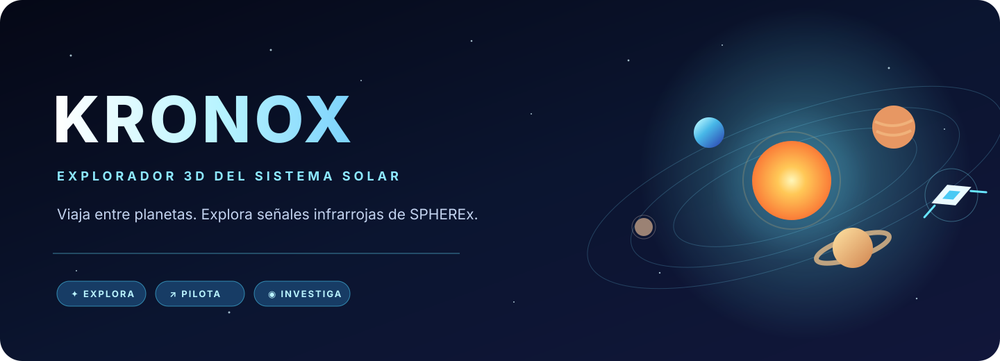

<div align="center">



**Explora el sistema solar · Sigue las señales · Descubre el cielo infrarrojo**

[🚀 Abrir KRONOX](https://kronox-delta.vercel.app) · [📖 Guía de usuario](docs/GUIA_USUARIO.md) · [🧭 Arquitectura](docs/ARQUITECTURA.md)


</div>

---

## ✨ ¿Qué puedes hacer?

| 🪐 Explorar | 🚀 Pilotar | 🔭 Investigar |
|---|---|---|
| Recorre el Sol, los planetas y una Vía Láctea esquemática en una escena WebGL. Cambia escalas, fecha y velocidad de simulación. | Alterna entre cámara orbital, cámara libre y nave. Vuela manualmente o usa viajes rápidos, saltos espaciales y piloto automático. | Busca observaciones infrarrojas públicas de SPHEREx, compara fechas, marca lo que encuentres y descarga tus notas en CSV. |

- Consulta fichas planetarias con imágenes y referencias de NASA.
- Recibe avisos de Kronox y activa su voz en español.
- Explora en escritorio o usa los controles táctiles para pilotar en móvil.

## 🛰️ Novedades de la misión SPHEREx

La consola **Ecos en infrarrojo** ahora permite elegir entre dos tipos de misión:

- **Rastreo de estrellas:** busca movimientos de fuentes cercanas frente al fondo estelar.
- **Estrellas variables:** compara observaciones para investigar cambios de brillo.

Selecciona uno de cinco objetivos —Estrella de Barnard, Epsilon Indi B, WISE 0855, RW Aurigae o R Draconis— o introduce coordenadas ICRS. Elige el archivo QR2 o QR3, filtra por banda y recorre la secuencia de observaciones con la línea de tiempo o reproducción automática.

**Flujo de investigación:** llega al observatorio con un salto espacial → revisa los recortes FITS de varias fechas → pulsa **Marcar objeto** y anota el cambio observado → guarda varios hallazgos → descarga el conjunto como CSV.

> Las marcas y notas viven en la sesión actual de la aplicación. Descarga el CSV antes de cerrar o recargar si quieres conservarlas. El color de la imagen es una ayuda de visualización, no luz visible ni fotometría calibrada.

## 🕹️ Controles rápidos

| Acción | Control |
|---|---|
| Orbitar la cámara | Arrastrar con botón izquierdo |
| Acercar / alejar | Rueda del ratón |
| Desplazar la cámara | Arrastrar con botón derecho |
| Mover la nave | `W` `A` `S` `D` |
| Subir / bajar | `E` / `Q` |
| Acelerar temporalmente | `Shift` |
| Pilotar en móvil | Controles táctiles en pantalla |

La cámara de nave puede cambiar entre primera y tercera persona. El menú de viaje rápido incluye planetas y puntos de interés galácticos.

## 🧰 Tecnologías

| Área | Tecnología |
|---|---|
| Interfaz | React 18, ReactDOM 18, JSX y CSS |
| Escena 3D | Three.js 0.128.0, WebGL y controles orbitales |
| Desarrollo y build | Node.js 20.19+ o 22.12+, npm, Vite 8 y `@vitejs/plugin-react` |
| API | Funciones serverless de Vercel (Node.js) |
| Datos astronómicos | Catálogos locales y archivo público NASA/IPAC IRSA para SPHEREx |
| Servicios externos | NASA para imágenes, IRSA para observaciones y Google Translate TTS para voz |

Las versiones y dependencias instaladas se detallan en `package.json` y `package-lock.json`.

## 🏗️ Cómo está organizado

```text
.
├── api/
│   ├── spherex.js              # Búsqueda IRSA y recortes FITS
│   └── voice.js                # Voz en español
├── docs/
│   ├── ARQUITECTURA.md
│   ├── FUENTES_Y_LIMITACIONES.md
│   └── GUIA_USUARIO.md
├── src/
│   ├── components/             # Interfaz, controles y misiones
│   ├── data/                   # Datos planetarios y objetivos SPHEREx
│   ├── scene/createScene.js    # Escena y simulación Three.js
│   ├── utils/fitsImage.js      # Lectura y visualización FITS
│   ├── App.jsx                 # Composición y estado de la aplicación
│   └── styles.css
├── index.html
├── package.json
├── vercel.json
└── vite.config.js
```

### Servicios de la misión

```text
Navegador ── /api/spherex?action=search ──> NASA/IPAC IRSA (catálogo SIA)
Navegador ── /api/spherex?action=frame  ──> NASA/IPAC IRSA (recorte FITS)
Navegador ── /api/voice                 ──> Google Translate TTS
```

La búsqueda SPHEREx valida las coordenadas, limita el radio de consulta y devuelve hasta 250 resultados. La acción de recorte valida el origen esperado en IRSA y solicita un campo de 0,5°. El endpoint de voz acepta español latino o de España y hasta 200 caracteres. Estas funciones no guardan datos en una base de datos.

## ▶️ Ejecutar localmente

**Requisitos:** Node.js 20.19+ o 22.12+, npm y un navegador con WebGL.

```bash
npm ci
npm run dev
```

Para compilar y previsualizar la versión de producción:

```bash
npm run build
npm run preview
```

La carpeta generada es `dist/`. `npm run format` aplica Prettier y modifica archivos.

## ☁️ Publicación

El frontend se puede servir como sitio estático. Para habilitar la búsqueda SPHEREx y la voz se necesita desplegar también `api/` en Vercel; `vercel.json` configura Vite y la salida `dist`.

La base de ruta de Vite es `/` en Vercel y `/KRONOX/` en otros entornos, configuración pensada para GitHub Pages. En un alojamiento estático sin funciones serverless, la exploración 3D seguirá disponible, pero las consultas de misión y voz no tendrán backend.

## 🔍 Guía de auditoría y traspaso

Usa esta sección para revisar el proyecto con tu compañero. Registra siempre la rama, el commit y el entorno que realmente se inspeccionaron.

### Sistemas que debe cubrir la revisión

1. **Escena y simulación:** ciclo de render, limpieza de listeners y recursos WebGL; escalas visual y física; fecha y velocidad.
2. **Vuelo y navegación:** entradas de teclado y táctiles, cámaras, piloto automático, inercia, destinos y saltos.
3. **Fichas y datos:** catálogo planetario, referencias, imágenes externas y claridad de las limitaciones científicas.
4. **Asistente y voz:** avisos, accesibilidad, idioma, consentimiento y transmisión de texto a Google.
5. **SPHEREx:** selección de misión, validación de coordenadas, filtrado, reproducción, lectura FITS, anotaciones y exportación CSV.
6. **API e infraestructura:** validación de solicitudes, respuestas de IRSA, límites de tamaño/tiempo, caché, errores y publicación de Vercel.

### Puntos de atención

Estos son temas para verificar; no representan vulnerabilidades confirmadas.

- Los endpoints serverless son públicos y no requieren autenticación: revisar rate limiting, tamaño de respuesta y controles de abuso.
- Revisar límites de memoria/tiempo al descargar y procesar productos FITS, errores de upstream y protección frente a respuestas inesperadas.
- Confirmar la validación del URL upstream y el manejo de redirecciones en la función de recorte.
- Revisar qué información se transmite a IRSA y que el texto enviado a Google para la voz esté explicado al usuario.
- Comprobar dependencias y licencias, desempeño WebGL, dispositivos móviles, accesibilidad y manejo de errores.
- `package.json` no declara scripts de tests, lint ni typecheck; registrar esto como limitación de cobertura, no como prueba de fallo.

### Registro de revisión

| Campo | Valor |
|---|---|
| Auditor/a y fecha | _Completar_ |
| Rama y commit SHA | _Completar_ |
| Entorno y versiones de Node/npm | _Completar_ |
| Alcance y exclusiones | _Completar_ |
| Comandos ejecutados y resultados | _Completar_ |
| Limitaciones de acceso o datos | _Completar_ |

### Plantilla de hallazgo

```text
[ID] Título — Prioridad P0 / P1 / P2 / P3
Área:
Ubicación (archivo, función o endpoint):
Descripción y condición observada:
Pasos para reproducir:
Impacto:
Evidencia (sin secretos ni datos personales):
Recomendación concreta:
Estado / responsable / fecha objetivo:
```

Prioriza según impacto, probabilidad y exposición: **P0 crítica**, **P1 alta**, **P2 media**, **P3 baja**. Separa defectos reproducidos de recomendaciones preventivas.

## ⚠️ Alcance científico y dependencias

KRONOX es una experiencia educativa y visual, no una herramienta de navegación espacial ni de efemérides de precisión. La escala visual altera tamaños y distancias; las órbitas son aproximadas, y la Luna y la Vía Láctea están simplificadas. Los recortes FITS conservan una escala de visualización para facilitar comparaciones, pero no sustituyen análisis fotométrico calibrado.

La experiencia depende de conexión a internet para imágenes, observaciones de IRSA y voz. El texto de cada aviso hablado se envía a Google Translate para generar audio. La disponibilidad y cadencia de SPHEREx varían según el objetivo y los datos publicados en QR2/QR3.

## 📚 Documentación

- [Guía de usuario](docs/GUIA_USUARIO.md)
- [Arquitectura y desarrollo](docs/ARQUITECTURA.md)
- [Fuentes, datos y limitaciones](docs/FUENTES_Y_LIMITACIONES.md)
- [Registro de cambios](CHANGELOG.md)
