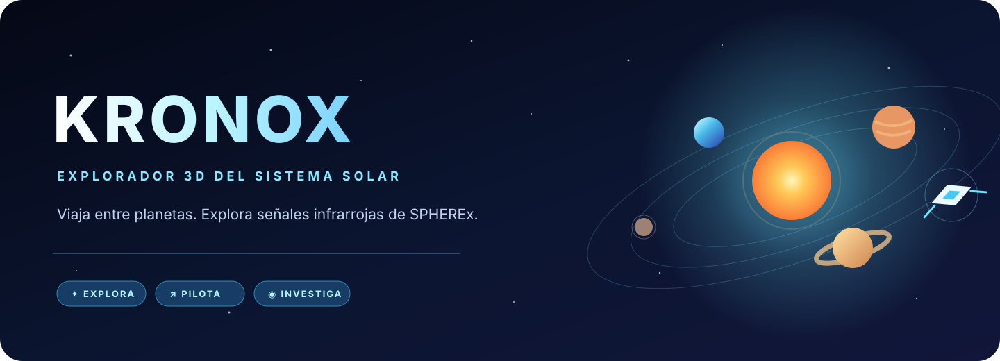

<div align="center">



**Explora el sistema solar · Sigue las señales · Descubre el cielo infrarrojo**

[🚀 Abrir KRONOX](https://kronox-delta.vercel.app) · [📖 Guía de usuario](docs/GUIA_USUARIO.md) · [🧭 Arquitectura](docs/ARQUITECTURA.md) · [📚 Wiki del proyecto](docs/wiki/README.md)


</div>

---

## 🌌 KRONOX en breve

KRONOX es una aplicación web educativa e interactiva que combina una exploración 3D del sistema solar con una consola para consultar y comparar observaciones infrarrojas públicas de la misión **SPHEREx**. El usuario puede recorrer el espacio con una nave, aprender sobre los planetas y revisar recortes astronómicos en una interfaz disponible en español e inglés.

| 🪐 Explorar | 🚀 Pilotar | 🔭 Investigar |
|---|---|---|
| Recorre el Sol, los planetas, cinco planetas enanos y una Vía Láctea con mayor profundidad visual. Ajusta escalas, fecha y velocidad de simulación. | Usa cámaras orbital, libre y de nave; viaja a destinos rápidos, realiza saltos espaciales y pilota con telemetría, zoom de tercera persona e indicaciones durante el trayecto. | Busca observaciones SPHEREx, compara dos fechas con alineación WCS, registra notas sobre hallazgos y expórtalas a CSV. |

También incluye texturas procedurales para planetas enanos, asteroides y lunas, satélites más visibles, entrada a la nave desde la Tierra, fichas planetarias con referencias de NASA, Kronox en español e inglés y controles táctiles para móvil. Las preferencias incluyen calidad gráfica, alto contraste, reducción de movimiento y sonidos de juego opcionales.

## Novedades desde la actualización anterior

Se revisaron **31 commits**, desde `e1b29b6` hasta `3d344e5`. Estos son los cambios incorporados:

- **Sistema solar y cuerpos menores:** se añadieron Ceres, Plutón, Haumea, Makemake y Eris con órbitas aproximadas, texturas procedurales y acceso desde viajes rápidos. Se renovó el aspecto de sus superficies, se mejoraron las texturas de las lunas de Júpiter, se redujo el tamaño y se amplió la cantidad de satélites terrestres, y se sincronizaron y ralentizaron los movimientos visuales de Júpiter. Commits: `e923acf`, `48ea36b`, `5e6ae7e`, `18a1231`, `aeceea3`, `df77f15`, `fecfa38`, `f6e61a8`, `c71ef53`, `6b2b21e`.
- **Vía Láctea y entorno:** se dio más volumen a la vista galáctica, se separaron visualmente sistemas estelares próximos y se añadieron estrellas con textura y asteroides 3D. Una prueba de visualización del espolón de Orión se revirtió después; esas mejoras no forman parte de la vista actual. Commits: `3d344e5`, `159716b`, `74b927a`, `5e65869`, `2755903`.
- **Nave y viajes:** se ajustaron escala, encuadre y perspectiva de la nave junto a los planetas; la vista de tercera persona ahora ofrece zoom y mantiene la nave visible. El ingreso a la nave comienza desde la Tierra con una secuencia de lanzamiento. Commits: `60af42d`, `de4b7e4`, `5ba92f3`, `a09f322`, `b64fca6`, `ecd0f88`, `323b971`.
- **Viajes de misión y simulación:** los viajes de misión se pueden acelerar y muestran consejos de velocidad; sus avisos y el mensaje de lanzamiento se tradujeron. También se revisaron los controles de nombres y la velocidad inicial, que ahora parte de **0,10 días simulados por segundo**. Commits: `0b4dd7d`, `267cd6d`, `b579e97`, `b4f6e14`, `23af5fb`, `c8f0848`, `774c2ca`, `9816d6e`.
- **Accesibilidad y respuesta de vuelo:** se añadieron preferencias de calidad gráfica, alto contraste y movimiento reducido; la opción de movimiento reducido también se respeta en los viajes guiados. Hay señales sonoras opcionales, una indicación de progreso de navegación y ajustes a los controles y a la interacción con las fichas planetarias. Commits: `9bed709`.

## 🛰️ Consola SPHEREx: Ecos en infrarrojo

La consola integra selección de misión, objetivos astronómicos, navegación hasta el observatorio y visualización de recortes FITS. Permite trabajar con los archivos públicos **QR2** y **QR3**, filtrar observaciones por banda y recorrerlas mediante una línea de tiempo o reproducción automática.

### Flujo de investigación

1. Selecciona una misión y uno de los objetivos sugeridos, o introduce coordenadas ICRS (RA/Dec).
2. Consulta observaciones disponibles y filtra por banda infrarroja.
3. Elige dos fechas de observación para comparar sus imágenes.
4. Marca una posición en cualquiera de las imágenes y añade una nota.
5. Descarga las anotaciones como archivo CSV.

Los tipos de misión orientan la exploración hacia el rastreo de estrellas y el estudio visual de estrellas variables. Hay objetivos sugeridos como Estrella de Barnard, Epsilon Indi B, WISE 0855, RW Aurigae y R Draconis.

### Comparación de imágenes

- **Dos fechas elegibles:** selecciona cualquier par entre las observaciones disponibles; se muestran lado a lado.
- **Alineación celeste:** KRONOX lee el WCS de los encabezados FITS y reproyecta las imágenes a una cuadrícula común. Tiene en cuenta matrices CD/PC y términos de distorsión SIP cuando están disponibles.
- **Retícula de referencia:** presenta la posición celeste del objetivo, con norte arriba y este a la izquierda.
- **Escala visual coherente:** mantiene el estiramiento de brillo dentro de la secuencia y deja transparentes las zonas sin cobertura.
- **Anotaciones:** registra objetivo, banda, fechas, posición del marcador y nota en CSV. Las marcas se conservan en la sesión actual, no en una base de datos.
- **Visor ampliado:** permite examinar mejor las imágenes y cerrarlo con Escape.

> La reproyección sirve para comparar la posición aparente de las fuentes; no equivale a una calibración científica ni a fotometría. El color es una ayuda de visualización y no representa luz visible.

## 🌐 Idiomas y voz

La interfaz está disponible en **español e inglés**. KRONOX puede sugerir un idioma a partir del navegador o del país informado por Vercel, permite elegirlo manualmente y recuerda la preferencia en el navegador. Los controles de vuelo y los avisos de misión también están traducidos. La voz usa Google Translate TTS y acepta español latino, español de España e inglés de EE. UU.; los avisos hablados se envían al servicio para generar audio.

## 🕹️ Controles rápidos

| Acción | Control |
|---|---|
| Orbitar la cámara | Arrastrar con botón izquierdo |
| Acercar / alejar | Rueda del ratón |
| Desplazar la cámara | Arrastrar con botón derecho |
| Mover la nave | `W` `A` `S` `D` |
| Subir / bajar | `E` / `Q` |
| Acelerar temporalmente | `Shift` |
| Pilotar en móvil | Controles táctiles en pantalla |

La cámara de nave puede alternar entre primera y tercera persona; la vista en tercera persona incluye zoom y encuadre ajustable. Los viajes guiados muestran el avance y permiten acelerar el trayecto. El menú de viaje rápido incluye planetas, planetas enanos y puntos de interés galácticos. En las preferencias se puede ajustar la calidad gráfica, activar alto contraste o reducir animaciones y movimiento.

## 🧰 Tecnologías y servicios

| Área | Tecnología / servicio |
|---|---|
| Interfaz | React 18, ReactDOM 18, JSX, CSS y JavaScript ES modules |
| Escena 3D | Three.js 0.128.0, WebGL y OrbitControls |
| Desarrollo y compilación | Node.js 20.19+ o 22.12+, npm, Vite 8 y `@vitejs/plugin-react` |
| Formato de código | Prettier |
| Funciones backend | Vercel Functions para Node.js |
| Observaciones SPHEREx | NASA/IPAC Infrared Science Archive (IRSA), catálogo SIA y servicio IBE para recortes FITS |
| Imágenes y contenido | Recursos públicos de NASA y catálogos locales del proyecto |
| Voz | Google Translate TTS |
| Sonidos de juego | Efectos y ambiente opcionales sintetizados en el navegador |
| Preferencia de idioma | Traducciones español/inglés y sugerencia regional con Vercel |

Las versiones exactas y dependencias se encuentran en `package.json` y `package-lock.json`. El procesamiento y la reproyección de imágenes FITS se realizan en el navegador con utilidades propias del proyecto.

## 🏗️ Arquitectura del repositorio

```text
.
├── api/
│   ├── locale.js               # Sugerencia de idioma por país en Vercel
│   ├── spherex.js              # Búsquedas IRSA y descarga de recortes FITS
│   └── voice.js                # Proxy de voz Google Translate TTS
├── docs/
│   ├── ARQUITECTURA.md         # Componentes y flujo de datos
│   ├── FUENTES_Y_LIMITACIONES.md
│   ├── GUIA_USUARIO.md
│   ├── kronox-banner.svg       # Portada vectorial del README
│   └── kronox-badges.svg       # Insignias vectoriales locales
├── src/
│   ├── components/             # Interfaz, escenas de misión, controles y fichas
│   ├── data/                   # Datos planetarios y objetivos SPHEREx
│   ├── scene/createScene.js    # Escena, objetos y simulación Three.js
│   ├── utils/fitsImage.js      # Lectura FITS, WCS y reproyección celeste
│   ├── i18n.js                 # Traducciones y preferencia de idioma
│   ├── App.jsx                 # Composición y estado de la aplicación
│   ├── main.jsx                # Punto de entrada React
│   └── styles.css
├── index.html
├── package.json
├── vercel.json
└── vite.config.js
```

### Flujo de datos de SPHEREx

```text
Interfaz ── /api/spherex?action=search ──> IRSA SIA (búsqueda de observaciones)
Interfaz ── /api/spherex?action=frame  ──> IRSA IBE (recorte FITS)
Interfaz ── src/utils/fitsImage.js ─────> WCS/FITS → cuadrícula celeste común
Interfaz ── /api/locale ────────────────> País detectado por Vercel → idioma sugerido
Interfaz ── /api/voice ─────────────────> Google Translate TTS → audio
```

La búsqueda valida coordenadas, limita el radio y devuelve hasta 250 resultados. La acción de recorte valida el origen IRSA y solicita un campo de 0,5°. La función de voz acepta hasta 200 caracteres. Las anotaciones no se guardan en servidor: se mantienen durante la sesión y el usuario las exporta manualmente.

## ▶️ Ejecutar localmente

**Requisitos:** Node.js 20.19+ o 22.12+, npm y navegador con soporte WebGL.

```bash
npm ci
npm run dev
```

Para compilar y previsualizar la versión de producción:

```bash
npm run build
npm run preview
```

La salida se genera en `dist/`. `npm run format` aplica Prettier y modifica los archivos.

## ☁️ Publicación

El frontend se puede servir como sitio estático. Para habilitar consultas SPHEREx, sugerencia regional de idioma y voz se deben desplegar también las funciones de `api/` en Vercel; `vercel.json` configura Vite y la salida `dist`.

Vite usa la ruta base `/` en Vercel y `/KRONOX/` en otros entornos, configuración prevista para GitHub Pages. Sin funciones serverless, la escena 3D sigue disponible, pero las consultas de misión y los endpoints de voz/localización no tienen backend.

## 🔍 Guía de auditoría y traspaso

Para que la revisión sea reproducible, anota la rama, el SHA del commit, el entorno y las limitaciones de acceso inspeccionados.

### Sistemas que debe cubrir la revisión

1. **Escena y simulación:** ciclo de renderizado, limpieza de eventos y recursos WebGL, escalas visual/física, fecha y velocidad.
2. **Vuelo y navegación:** entradas de teclado/táctiles, cámaras, piloto automático, inercia, destinos y saltos.
3. **Fichas y datos:** catálogo planetario, referencias, recursos externos y limitaciones científicas descritas.
4. **Idioma y voz:** traducciones completas, persistencia de preferencia, accesibilidad y datos enviados al proveedor de voz.
5. **SPHEREx/FITS:** validación de coordenadas, filtros y fechas, respuestas de IRSA, lectura de encabezados, reproyección WCS/SIP, transparencia, ampliación y exportación CSV.
6. **API e infraestructura:** validación de solicitudes, límites, caché, errores del servicio externo y configuración Vercel/GitHub Pages.

### Puntos de atención

Son temas para verificar durante la auditoría; no representan vulnerabilidades confirmadas.

- Los endpoints serverless son públicos y no requieren autenticación: revisar límites de uso, tamaño de respuesta y controles contra abuso.
- Revisar memoria y tiempo de ejecución al descargar/procesar FITS, errores del servicio externo y respuestas inesperadas.
- Confirmar la validación de URLs upstream y el manejo de redirecciones en la función de recorte.
- Revisar qué información se transmite a IRSA y a Google Translate TTS; no enviar datos sensibles en las notas o mensajes.
- Comprobar dependencias y licencias, rendimiento WebGL, experiencia móvil, accesibilidad y tratamiento de errores.
- `package.json` no declara scripts de pruebas, lint ni typecheck; anótalo como limitación de cobertura, no como prueba de fallo.

### Registro de revisión

| Campo | Valor |
|---|---|
| Auditor/a y fecha | _Completar_ |
| Rama y commit SHA | _Completar_ |
| Entorno y versiones de Node/npm | _Completar_ |
| Alcance y exclusiones | _Completar_ |
| Comandos ejecutados y resultados | _Completar_ |
| Limitaciones de acceso o datos | _Completar_ |

### Plantilla de hallazgo

```text
[ID] Título — Prioridad P0 / P1 / P2 / P3
Área:
Ubicación (archivo, función o endpoint):
Descripción y condición observada:
Pasos para reproducir:
Impacto:
Evidencia (sin secretos ni datos personales):
Recomendación concreta:
Estado / responsable / fecha objetivo:
```

Prioriza según impacto, probabilidad y exposición: **P0 crítica**, **P1 alta**, **P2 media**, **P3 baja**. Separa defectos reproducidos de recomendaciones preventivas.

## ⚠️ Alcance y limitaciones

KRONOX es una experiencia educativa y visual, no una herramienta de navegación espacial ni de efemérides de precisión. La escala visual altera tamaños y distancias; las órbitas son aproximadas, y la Luna y la Vía Láctea se representan de forma simplificada. Las imágenes reproyectadas facilitan la comparación visual, pero no sustituyen análisis astrométrico o fotométrico calibrado.

La aplicación depende de internet para imágenes, observaciones IRSA y voz. El texto de los avisos se envía a Google Translate TTS para generar audio. La disponibilidad y cadencia de SPHEREx varían según el objetivo y los datos publicados en QR2/QR3. No hay base de datos ni sistema de cuentas para guardar sesiones o hallazgos.

## 📚 Documentación

- [Guía de usuario](docs/GUIA_USUARIO.md)
- [Arquitectura y desarrollo](docs/ARQUITECTURA.md)
- [Fuentes, datos y limitaciones](docs/FUENTES_Y_LIMITACIONES.md)
- [Registro de cambios](CHANGELOG.md)
