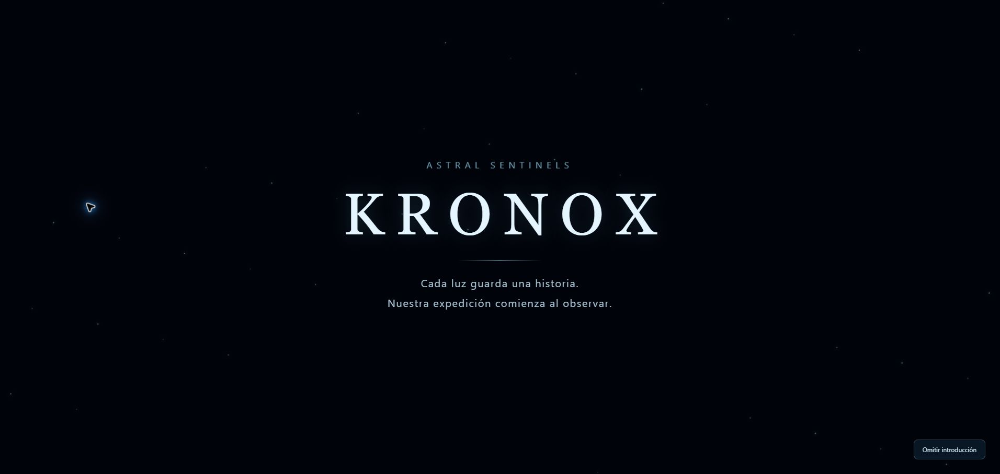
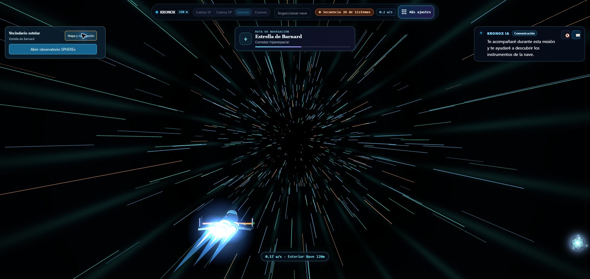
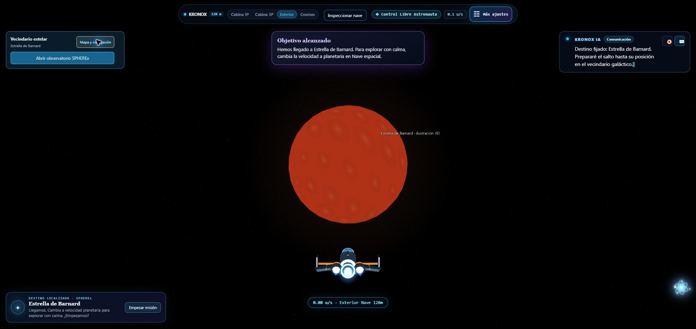
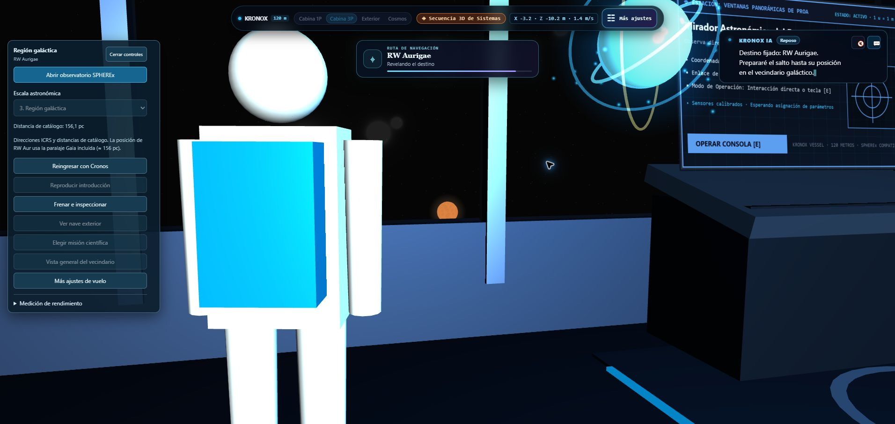
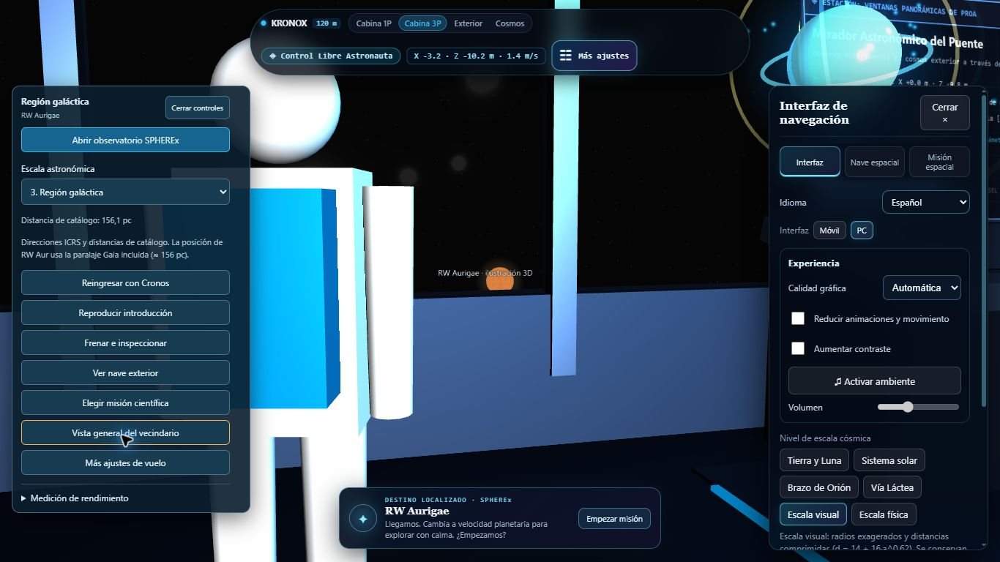

# Kronox · restauración cinematográfica y navegación

**Fecha:** 7 de noviembre de 2026, America/Bogota. **Copia intervenida:** C:\Users\OPPENHEIMER\Desktop\kronox-juan. **Resultado:** introducción recuperada, viajes con seis fases visibles, orientación de llegada persistente y paneles separados. Entrega: kronox-cinematica.zip.

## Alcance y conservación

Se reutilizaron el despegue, la entrada a la cabina, la nave y Cronos ya presentes en el código. No se reconstruyeron estrellas, galaxias, nebulosas, iluminación ni modelos. Los 217 archivos protegidos de la línea base conservan su SHA-256; entre ellos están los recursos públicos, catálogos, API, consultas IRSA, FITS, análisis, RGB, galería, modelos de cabina y código de Cronos. El bloque de 56.167 caracteres que construye texturas y objetos de la escena también es idéntico al respaldo.

Los 129 archivos registrados del original KRONOX-main siguen intactos. No hubo operaciones Git ni cambios remotos. Respaldo anterior a la intervención: **before.json.gz**, 74 archivos con contenido base64 y hash verificado. El auxiliar de pruebas anterior también se conserva en **sceneHarness-before.mjs**. Integridad completa: [integridad.json](integridad.json).

## Causas encontradas y correcciones

| Problema | Causa concreta | Corrección localizada |
|---|---|---|
| La nave desaparecía durante viajes largos | La propia condición de visibilidad la ocultaba durante el estado de tránsito | Se mantiene visible en vista exterior durante todas las fases. Se comprueban frustum, near/far y proyección de la nave en cada fotograma de las pruebas de integración. |
| Llegada mirando en dirección incorrecta | La animación aplicaba un quaternion temporal, mientras los ángulos del control manual conservaban el rumbo anterior | La navegación sincroniza yaw/pitch y el quaternion en cada paso, incluido el último. Se anulan inercia, bank y entradas residuales antes de devolver el control. |
| Cámara que podía perder la nave durante el giro inicial | Posición inicial de cámara expresada en un marco distinto al giro de la nave | La preparación interpola posición y orientación dentro del marco local de la nave. Después la cámara mira al destino con una sola secuencia al mando. |
| Destino oculto dentro de cabina | Consolas, montantes del parabrisas y, en un encuadre previo, el volumen de Cronos interceptaban la vista; la cámara 3P también podía apuntar a través del brazo | Se usa un mirador a babor entre los montantes, una aproximación lateral a esa posición y mayor separación de llegada en cabina. La cámara 3P conserva su seguimiento con 0,55 m de desplazamiento lateral para liberar la línea de visión. No se modifica ningún modelo. |
| Paneles superpuestos al primer arranque | Los estilos del puente dependían de la apertura diferida del observatorio; además, los offsets fijos no seguían la barra superior al envolver líneas | Se cargan esos estilos con el puente y se mide la altura real de su barra. Mapa a la izquierda y ajustes a la derecha, con desplazamiento propio y controles de cierre. |
| Diálogo que tapaba el cierre de ajustes y avisos detrás de la barra | Las tarjetas flotantes conservaban posiciones independientes del nuevo layout | El diálogo se aparta mientras están abiertos los ajustes y vuelve al cerrarlos. Los avisos respetan la altura de la barra y la oferta de misión se separa del mapa abierto. |

Se verificó el eje frontal en la geometría existente: cono de proa en −Z y motores en +Z. El destino se resuelve con su posición mundial dentro de la jerarquía activa. La posición de llegada se calcula antes del recorrido y se mantiene al liberar la cámara. El observador queda fuera del objeto y este queda delante, aproximadamente centrado.

## Animaciones y transiciones

El nuevo prólogo original presenta oscuridad, puntos estelares, **ASTRAL SENTINELS**, **KRONOX** y una frase sobre observación astronómica. Continúa con la secuencia existente de despegue, revelación exterior, aproximación, abordaje y activación de Cronos. Puede omitirse y repetirse desde el mapa. No se añadieron medios, música, logotipos ni recursos de las películas de referencia. Con movimiento reducido se muestra un prólogo estático de 2,5 s y se pasa directamente a cabina.

El viaje usa la máquina **IDLE → PREPARING → ACCELERATING → HYPERSPACE_ENTRY → HYPERSPACE_CRUISE → HYPERSPACE_EXIT → ARRIVING → IDLE**. Duraciones normales en segundos: **1,15 / 1,40 / 1,85 / 4,80 / 1,70 / 1,30**, total **12,20 s**, además de la cuenta atrás existente. Los recorridos cortos y el movimiento reducido acortan el efecto. Los tiempos son configurables en jumpSequence.js o mediante configureTravelDurations; se integran con deltaTime, no por conteo de fotogramas.

Durante la aceleración crecen el desplazamiento y las primeras estelas. La entrada alarga los trazos, forma el corredor y desplaza un umbral luminoso en profundidad. El crucero mantiene el flujo longitudinal; la salida reduce estelas y opacidad hasta revelar el campo y destino originales. No hay sustitución instantánea del fondo ni pantalla de carga. El hiperespacio es narrativo, no una simulación física superlumínica.

Durante un salto se bloquean cambios de cámara/escala incompatibles; frenar o reingresar cancela la secuencia y elimina sus recursos. Los controles de velocidad siguen disponibles para vuelo manual; ya no aparece el aviso antiguo que prometía acelerar una cinemática cambiando ese valor.

## Optimización

El corredor se crea solo al necesitarlo, en la misma escena: tres objetos de dibujo, 440 trazos en modo de rendimiento o 720 en el normal, un cilindro de baja complejidad y un umbral. Los shaders actualizan uniforms; no se duplican escenas astronómicas ni se generan texturas nuevas por fotograma. Se liberan exactamente las seis geometrías/materiales propios al terminar, cancelar o destruir la escena. El Canvas heredado de velocidad solo se redimensiona cuando cambia la ventana. Los efectos se atenúan con movimiento reducido. El diagnóstico de oclusión se ejecuta al consultar la instantánea de prueba, no en cada render.

## Archivos

| Archivo | Cambio |
|---|---|
| src/scene/createScene.js | Integración de estados, cámara, llegada, visibilidad, intro, cancelación y diagnóstico |
| src/scene/jumpSequence.js · nuevo | Tiempos, fases, poses y parámetros visuales |
| src/scene/hyperspaceEffect.js · nuevo | Corredor temporal y liberación de recursos |
| src/components/CinematicOpening.jsx · nuevo | Prólogo original y botón de omisión |
| src/styles/cinematicNavigation.css · nuevo | Animación del prólogo y distribución adaptable de controles |
| src/utils/flightPanelLayout.js · nuevo | Medición de la barra y actualización de offsets |
| src/App.jsx | Estado de intro, reproducción, etiquetas de fase, cancelación y retirada del aviso de velocidad obsoleto |
| src/components/SpaceshipCockpit.jsx | Carga temprana de estilos existentes y bloqueo de vistas incompatibles |
| src/components/NavigationDock.jsx | Reproducción de intro y controles durante el viaje |
| tests/cinematic.test.mjs · nuevo | Seis pruebas de comportamiento y conservación |
| scripts/test-support/sceneHarness.mjs | Opciones para probar estados y preferencias reales de la escena |
| LEEME-JUAN.md, docs/cinematic-navigation-2026-11-07/, scripts/cinematic-package.ps1 | Instrucciones, respaldo, informe, evidencia y empaquetado |

## Verificación

**154/154 pruebas aprobadas**, tipos correctos y build correcto. Los seis casos nuevos comprueban orden temporal a 30 y 144 Hz, crecimiento y desaparición del efecto, movimiento reducido, liberación completa, introducción repetible, oclusiones y conservación por hash. La integración ejecuta **Barnard exterior → RW cabina 1P → M31 exterior → RW cabina 3P**, sin reiniciar; comprueba centrado y rumbo también 90 fotogramas después de devolver el control. La suite existente sigue validando vuelo manual, arranque, atlas, datos y observatorio.

Tras ejecutar la suite se enlazaron **79 módulos servidos por 5174**, con sus imports/exports resueltos. Esto vuelve a comprobar el arranque y el aislamiento de caché de Vite de la reparación anterior. Logs: [full-tests.txt](full-tests.txt), [typecheck.txt](typecheck.txt), [build.txt](build.txt), [client-modules.json](client-modules.json).

En **Edge real** se observaron prólogo, reproducción, omisión, entrada y Cronos; fases de salto y llegadas a Barnard, RW y M31. Las lecturas de consola realizadas no devolvieron errores ni avisos. Se abrieron ambos paneles a **1366×768** y **1920×1080**, se comprobó su separación y se cerraron los ajustes. El viewport temporal se restauró al acabar. [Medidas](paneles-medidas.json) y [registro](verificacion-navegador.json).

Las pruebas de integración CPU emplean Three.js real con un renderer simulado. Las siguientes capturas corresponden a la interfaz del navegador; no son renders generados ni mockups:

## Límites y pendientes

No quedaron fallos conocidos de esta intervención en las comprobaciones realizadas. La compilación conserva el aviso de paquetes mayores de 500 kB. No se midieron FPS ni memoria GPU en este equipo, por lo que no se promete un rendimiento concreto. La comprobación visual cubre las resoluciones de escritorio indicadas, no todos los dispositivos. Se conservan las limitaciones científicas anteriores del catálogo y las observaciones; esta entrega no añade imágenes ni cambia conclusiones espectrales.

## Ejecutar y revisar

Usa INICIAR-DEMO.ps1 o **npm.cmd run dev -- --host 127.0.0.1 --port 5174 --strictPort** dentro de kronox-juan. Abre http://127.0.0.1:5174/KRONOX/. **Mapa y navegación → Reproducir introducción** y **Elegir misión científica** permiten revisar la secuencia. Si se usa el ZIP en otra carpeta, instala dependencias con **npm.cmd ci**. El ZIP excluye dependencias instaladas, cachés, dist, metadatos Git, variables de entorno y ZIP anteriores; incluye el código, los datos locales y este respaldo.
