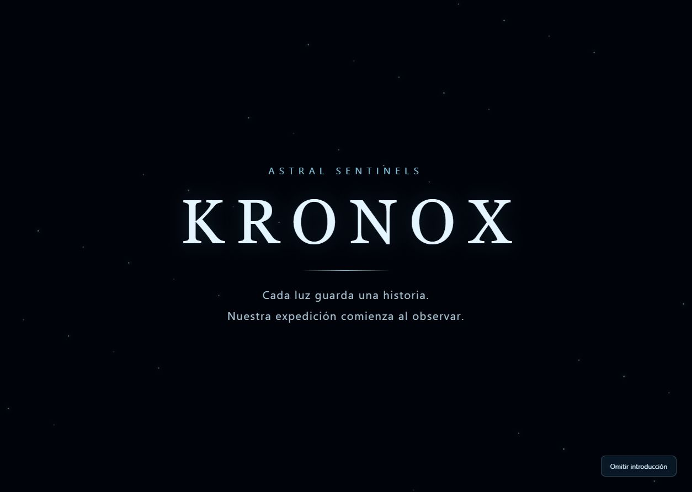

# Corrección del inicio automático de Kronox

Fecha: 7 de noviembre de 2026 (America/Bogota).

La página ahora reproduce automáticamente el prólogo original de Astral Sentinels/KRONOX, continúa con la secuencia de despegue y abordaje y entrega el control en la cabina. Se verificó sin pulsar ningún botón de inicio.

## Causa

El efecto de montaje de App.jsx seguía ejecutando free(true, false) y view(3) incondicionalmente. La introducción restaurada solo estaba conectada a los botones de bienvenida o reproducción. La verificación anterior confirmó el modo manual y no detectó que faltaba conectarla al inicio de página.

## Cambio

El arranque selecciona su recorrido una sola vez, después de crear la escena:

| URL | Comportamiento |
|---|---|
| /KRONOX/ | Introducción automática → cabina |
| ?welcome=false&voice=false | Introducción automática sin menú ni voz → cabina |
| ?welcome=true | Menú previo con las opciones existentes |
| ?intro=false | Entrada directa a cabina sin la secuencia |
| ?observatory=true o un enlace con target | Acceso científico directo existente |

Omitir y reproducir siguen disponibles. No se usa una marca de sesión para ocultar el prólogo en recargas. Se conservan las preferencias de movimiento reducido. No se modificaron el render exterior, el corredor, los datos ni los componentes científicos.

## Comprobación

**158 pruebas aprobadas**, tipos y compilación correctos. Los cuatro casos nuevos montan la App real y comprueban la URL normal, el enlace reportado, la finalización automática en cabina, la omisión, un nuevo montaje y el acceso explícito sin introducción. El caso existente del menú ahora lo solicita con welcome=true. Después se enlazaron 79 módulos del servidor local.

En el navegador integrado se recargó el enlace reportado y se observó el prólogo sin pulsar Reproducir; se dejó terminar y apareció la cabina con Cronos. También se abrió la URL normal y se comprobó Omitir introducción. Las lecturas de consola no devolvieron errores ni avisos. La captura siguiente corresponde a esa recarga real:

## Archivos y conservación

Se modificaron src/App.jsx, tests/startup.test.mjs y LEEME-JUAN.md. Se añadió tests/intro-autostart.test.mjs y la documentación de esta corrección. Los tres archivos previos están respaldados como *.before en esta carpeta. Los otros 528 archivos del paquete anterior conservan sus hashes; los 129 archivos registrados de KRONOX-main siguen intactos. No hubo operaciones Git ni despliegues.

Logs: full-tests.txt, typecheck.txt, build.txt y client-modules.json. Auditoría: integridad.json. La entrega actual es **kronox-cinematica-inicio-automatico.zip**, que incluye todo el proyecto y los datos locales. El paquete anterior se conserva como historial.
